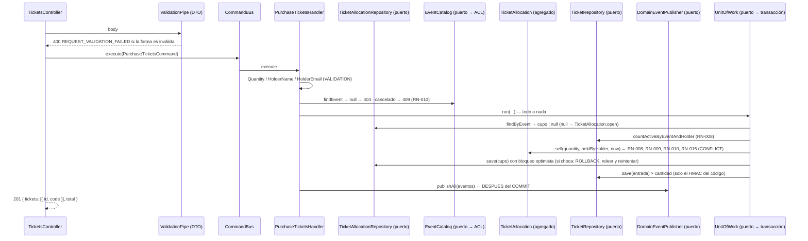

# Arquitectura: visión general

## Estilo

Arquitectura **hexagonal** (puertos y adaptadores) organizada **por contexto acotado**,
con **DDD táctico** dentro de cada contexto y **CQRS** en la capa de aplicación.

```
src/<contexto>/
├── domain/          Modelo de negocio. TypeScript puro.
│   ├── entities/        Agregados (Event, TicketAllocation, Ticket) con comportamiento e invariantes
│   ├── value-objects/   Constructor privado + factory estática + equals()
│   ├── events/          Hechos ocurridos (nombre en pasado), clases planas
│   ├── errors/          Subclases de DomainException con código estable
│   └── ports/           Interfaces + token Symbol (repositorios, catálogo, hasher, generador de códigos)
├── application/     Casos de uso. Depende SOLO de domain/ (puertos).
│   ├── commands/<caso>/  *.command.ts + *.handler.ts  (escritura)
│   ├── queries/<caso>/   *.query.ts + *.handler.ts    (lectura)
│   └── views/            Modelos de lectura (sin datos secretos)
└── infrastructure/  Adaptadores. Implementan los puertos o los invocan.
    ├── http/             Controladores + DTOs (adaptador de entrada)
    ├── persistence/
    │   ├── typeorm/      *.orm-entity.ts + *.mapper.ts + typeorm-*.repository.ts
    │   └── in-memory/    in-memory-*.repository.ts (pruebas)
    └── ...               security/ (HMAC, generador de códigos), adapters/ (ACL),
                          event-handlers/ (oyente externo, conciliación al arrancar)
```

`src/shared/` es el *shared kernel*: solo abstracciones genéricas (`DomainException`,
`AggregateRoot` con versión, `DomainEvent`, validación de formato UUID y los puertos
`DomainEventPublisher`, `Clock`, `IdGenerator` y `UnitOfWork`) y piezas de infraestructura
transversales: sus adaptadores (`SystemClock`/`FixedClock`, `CryptoIdGenerator`,
`TypeOrmUnitOfWork`/`InMemoryUnitOfWork` con `TypeOrmTransactionContext`), filtros HTTP,
`ValidationPipe`, autenticación por clave (`ApiKeyGuard`, `@RequireRoles`) y límite de
peticiones (`@SensitiveRoute`). **No** contiene value objects de negocio.

## Regla de dependencias

```
infrastructure ──► application ──► domain
```

| Capa | Puede importar | No puede importar |
|---|---|---|
| `domain/` | `shared/domain`, su propio `domain/` | `@nestjs/*`, `typeorm`, `class-validator`, módulos de Node (`node:crypto`...), `application/`, `infrastructure/`, otro contexto |
| `application/` | su `domain/`, `shared/domain`, `shared/application`, `@nestjs/cqrs`/`@nestjs/common` (decoradores) | `infrastructure/`, repositorios concretos, otro contexto, `new Date()`/`Math.random()` (usa los puertos) |
| `infrastructure/` | todo lo anterior, frameworks, la API pública de otro contexto (query/evento) | — |

Se **verifica automáticamente** en `test/architecture/architecture.spec.ts` (`pnpm test`).

## Flujo de un comando (ejemplo: `POST /tickets`, comprar entradas)



## CQRS

- Cada caso de uso tiene **su propia carpeta** con el comando/consulta y su handler.
- Los controladores solo construyen el mensaje y llaman a `CommandBus.execute` /
  `QueryBus.execute`. No acceden a repositorios, no llaman handlers, no contienen reglas.
- Los **comandos** devuelven lo mínimo (`{ id }`, o los códigos de entrada, que solo
  pueden entregarse en ese momento).
- Las **consultas** devuelven *views* construidas campo a campo.
- Los handlers **orquestan**: validan con value objects, cargan, delegan la decisión al
  agregado, persisten y publican. Las reglas viven en el dominio.

## Errores

- `DomainException` con `code` (estable) y `kind` (`VALIDATION | NOT_FOUND | CONFLICT`).
- `DomainExceptionFilter` (único) traduce a 400/404/409 con un `switch` exhaustivo.
- `HttpExceptionFilter` solo da la misma forma a los errores del framework (JSON mal formado,
  ruta inexistente, 401/403 de autenticación, 429 de límite de peticiones).
- `UnhandledExceptionFilter` es el último recurso: 413 de express sin ruido en el log y 500
  genérico para cualquier fallo del servidor (incluida una fila corrupta en la base), con
  el detalle solo en el log.
- Un error de negocio nunca produce 500, y un fallo del servidor nunca produce 400.
  Catálogo: [`../business-rules/error-catalog.md`](../business-rules/error-catalog.md).

## Validación en dos niveles

1. **Borde HTTP**: DTOs + `ValidationPipe` (`whitelist`, `forbidNonWhitelisted`, `transform`):
   forma, tipos y tamaños máximos. Ejemplo: `quantity: "2"` (texto) → 400.
2. **Dominio**: value objects e invariantes. Ejemplo: `quantity: 11` pasa el DTO (es un
   entero) pero el dominio responde `TICKET_INVALID_QUANTITY` (RN-008).

## Seguridad en el borde

- **Autenticación por clave de API con roles** (`ORGANIZER`, `GATE`) para las operaciones del
  personal; el resto es público (ADR-014).
- **Límite de peticiones** por IP, con uno más estricto en compra y check-in (ADR-014).
- `helmet`, cuerpo máximo de 100 kB, `whitelist` + `forbidNonWhitelisted`, mensajes de error
  sin eco de la entrada. Detalle: [`security-and-configuration.md`](security-and-configuration.md).

## Concurrencia y atomicidad

Todos los agregados llevan `version` (ADR-011): un guardado solo se aplica si nadie
modificó el agregado desde que se leyó. La compra guarda cupo y entradas en **una
transacción** (puerto `UnitOfWork`, ADR-013) y la reintenta entera, con espera aleatoria,
cuando otra operación cambió el cupo. El cupo serializa también la compra con la
cancelación del evento. Las operaciones disparadas por eventos (`CloseEventSales`) releen y
reintentan porque no pueden devolver un 409 a nadie, y la conciliación recupera los cierres
perdidos (ADR-016).
